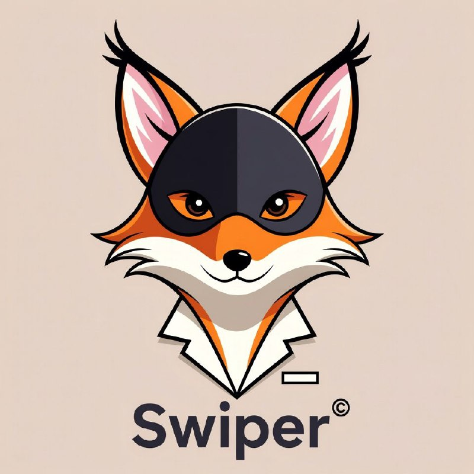
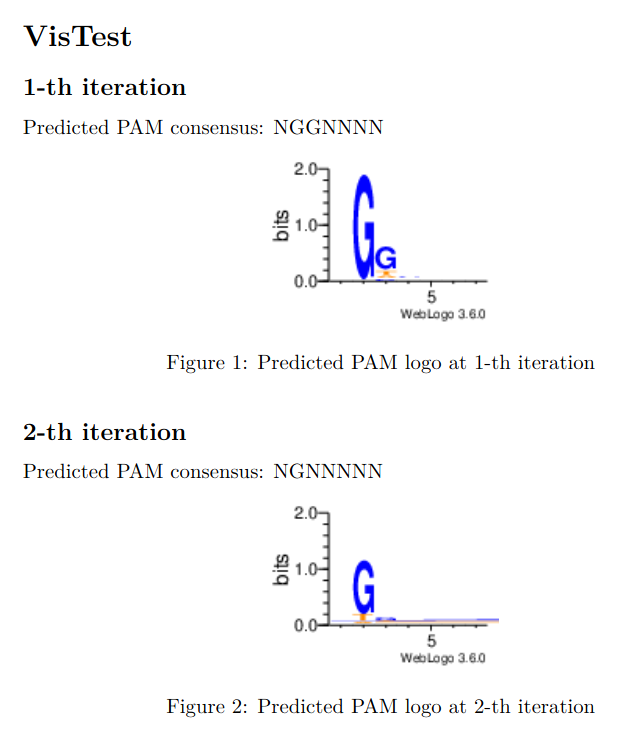
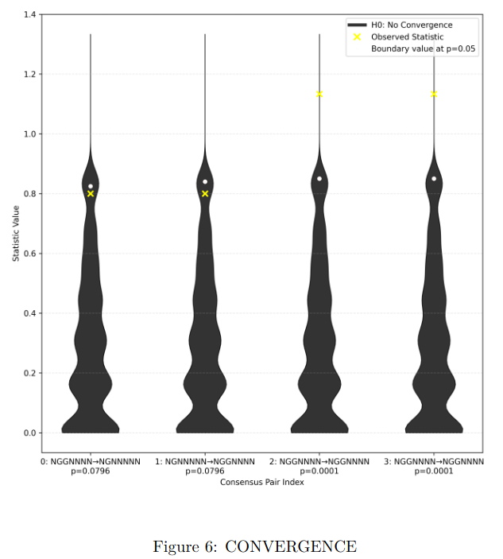

# Swiper




## Sequencing-free PAM discovery for CRISPR-Cas9 orthologs via active learning.

---
Swiper identifies the protospacer-adjacent motif (PAM) of an uncharacterized Cas9 ortholog from a small number of iterative cleavage assays guided by Active Machine Learning.

---
### Quick start

To install, run the following:
```bash

git clone https://github.com/bakirillov/swiper.git
cd swiper
pip install -r requirements.txt
```
After that create an excel file with list named 1 and the following structure as on the example below:
| # | PAM | Sequence | Outcome |
|---|-----|----------|---------|
| 0 | 3   | CTTCCGC  | -       |
| 1 | 4   | ATATGGG  | -       |
| 2 | 5   | AACGGGG  | -       |
| 3 | 6   | TAAGTGT  | -       |

Replace the sequences with your sequences and in ''Outcome'' input the results of your cleavages, ''-'' if no cleavage happened and ''+'' if cleavage is successful.

After that, run:
```bash

python ./src/swiper_cli.py -d YOURFILE.xlsx -p "./supplementary/Supplementary Data 3.fasta" -s YOUR_SEED -q YOUR_ROUND_SIZE -a -o "OUTPUT_MODEL_ARCHIVE_1" -t /tmp/swiper_workdir/

#Use -p None if you want to run against all possible k-mers of given k; 
#Use -p "./supplementary Data 3.fasta" if you are looking for 7nt candidate; 
#Use -p "./supplementary Data 2.fasta" if you are looking for 6nt candidate; 
#If you want your own Golden Set, generate it according to ./notebooks/EDF1.ipynb;
```
This will add list '2' to the original file with the next round sequences and save the model to OUTPUT_MODEL_ARCHIVE_1.zip. 

Order DNA synthesis. Perform cleavage assay and fill list '2' with the outcomes. Save new model in a different output archive. Repeat until convergence.

To visualize the results and identify convergence, run the following:

```bash

python ./src/swiper_vis.py --name YOUR_EXPERIMENT_NAME --output REPORT_NAME --experiments OUTPUT_MODEL_ARCHIVE_1.zip,OUTPUT_MODEL_ARCHIVE_2.zip,OUTPUT_MODEL_ARCHIVE_3.zip...and so on
```

This will create file REPORT_NAME.pdf with the following information (to reproduce, run scripts/visualization_test.sh):



For each attempt, the report shows a logo sequence and a consensus. 

If there is more than one archive, the script tests for convergence via the Monte-Carlo nonparametric statistical test:



If p-value for a pair is below your preferred threshold (e.g. 0.05), you can safely say "Swiper, no swiping!" and stop the experiments. The resulting PAM is given by the final attempt.

---
### Advanced usage

If you want to test predicted PAM for your protein generated by an AI, sample from your motif with something like that and optionally add some unrelated random sequences:

```python
import numpy as np
from Bio.Data import IUPACData

def sample_from_consensus(consensus, n=1):
    """Return n sequences sampled uniformly from a consensus with IUPAC codes."""
    iupac_map = IUPACData.ambiguous_dna_values
    return [
        "".join(np.random.choice([a for a in iupac_map[code]]) for code in consensus)
        for _ in range(n)
    ]

consensus = "NNGAVNN"
# Unrelated random sequences
random_seqs = ["".join(a) for a in 
               np.random.choice(list(iupac_map["N"]), (len(consensus), 9)).T]
samples = sample_from_consensus(consensus, n=9) + random_seqs
```

Order synthesis and perform cleavage assay, fill the Excel file as described above. From that point on, follow the "Quick start" instruction.

---
### Citation COMING SOON

If you use Swiper, please cite:

```latex
@article{<key>,
  title   = {Sequencing-Free Protospacer-Adjacent Motif Discovery for
             Uncharacterized CRISPR-Cas9 Orthologs via Active Learning},
  author  = {<authors>},
  journal = {<journal>},
  year    = {<year>},
  doi     = {<doi>}
}
```

---
### Reproduction instructions

To reproduce all the figures and tables from the paper, read and follow REPRODUCE.md.

---
### Data availability

Uncropped gel images are available at Zenodo (https://zenodo.org/records/23460858). The rest is available here (./data and ./supplementary).

---
### Contributing

Issues and pull requests are welcome. For questions about the method, open an issue or contact the corresponding author.
